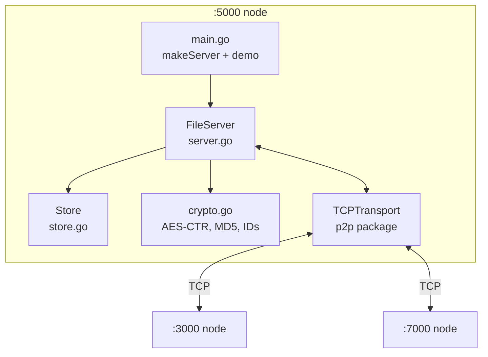

# Distributed File Storage (Go)

A peer-to-peer, content-addressable file store written in Go. Each node keeps its files on local disk and sends an encrypted copy to every connected peer. If a node loses a file, it fetches the file back from the network and decrypts it. There is no central server: every node runs the same code.

> Built following Anthony GG's [foreverstore](https://github.com/anthdm/distributedfilesystemgo) tutorial.

## Features

- **Peer-to-peer over TCP**: the transport layer sits behind a `Transport` interface, so it can be swapped out
- **Content-addressable storage**: each key is hashed with SHA-1 into a nested directory path
- **Encrypted replication**: replicas are encrypted with AES-256-CTR, with a random IV per file
- **Private filenames**: peers only see an MD5 hash of each key, never the original name
- **Network recovery**: `Get` reads from local disk first, then fetches from peers
- **Standard library only**: `testify` is used only in tests

## Architecture



| Layer | Files | Responsibility |
| --- | --- | --- |
| Entry | `main.go` | Builds nodes and runs the demo |
| Server | `server.go` | Peers, message loop, `Store` / `Get`, broadcast |
| Storage | `store.go` | CAS paths, read/write/delete on disk |
| Crypto | `crypto.go` | AES-256-CTR streams, key hashing, IDs |
| Network | `p2p/` | TCP transport, peers, framing, handshake hook |

### How it works

**Store(key)**
1. Writes the plaintext locally to `<root>/<nodeID>/<sha1 path>`.
2. Broadcasts a `MessageStoreFile{ID, md5(key), size}` (gob-encoded, prefixed with `0x1`).
3. Streams `0x2` + IV + ciphertext to all peers, and each peer saves it under the owner's ID.

**Get(key)**
1. Serves the file from local disk if it is there.
2. Otherwise it broadcasts `MessageGetFile`. Peers reply with `0x2` + an int64 size + the encrypted bytes.
3. Decrypts with the node's key, saves the file locally, and returns it.

**Wire format**: the first byte of each frame is `0x1` (a gob control message) or `0x2` (a raw stream). During a stream, the connection's read loop pauses until the server has consumed it.

### On-disk layout

```
:3000_network/<nodeID>/68044/29f74/181a6/3c50c/3d81d/733a1/2f14a/353ff/6804429f74181a63c50c3d81d733a12f14a353ff
```

## Getting started

Requires Go 1.18+.

```bash
git clone <your-repo-url>
cd distributedfilesystemgo

make run    # or: go run .
make test   # or: go test ./...
```

The demo starts three nodes (`:3000`, `:7000`, `:5000`) in one process. Node `:5000` stores 20 files, deletes each local copy, and fetches it back from its peers.

### Usage

```go
s := makeServer(":5000", ":3000", ":7000") // listen addr, bootstrap peers
go s.Start()

s.Store("photo.png", bytes.NewReader(data))
r, err := s.Get("photo.png")
```

## Project structure

```
.
├── main.go            # demo / node wiring
├── server.go          # FileServer: Store, Get, message handling
├── store.go           # content-addressable disk store
├── crypto.go          # AES-CTR encryption, hashing, IDs
├── p2p/
│   ├── transport.go   # Peer & Transport interfaces
│   ├── tcp_transport.go
│   ├── encoding.go    # frame decoder
│   ├── message.go     # RPC + frame type bytes
│   └── handshake.go
└── *_test.go
```

## Limitations / roadmap

- [ ] Replace the fixed `time.Sleep` coordination with acknowledgements
- [ ] Handle peers that don't have a requested file (`Get` currently blocks)
- [ ] Guard the `peers` map with its mutex everywhere
- [ ] Persist node ID and encryption key across restarts
- [ ] Add authenticated encryption (AES-GCM or an HMAC) for tamper detection
- [ ] Network-wide delete and selective replication (instead of all-to-all)
- [ ] Real handshake/authentication between peers
- [ ] CLI flags or a config file instead of hard-coded settings

## License

Add a license of your choice (e.g. MIT), and check the original repository's license terms too.
